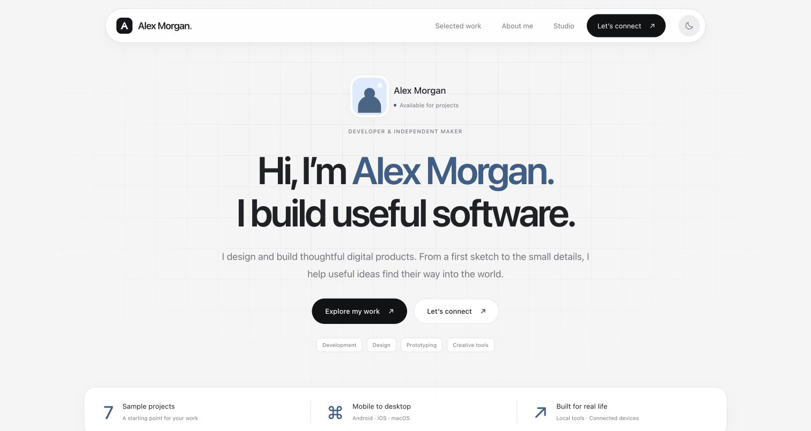
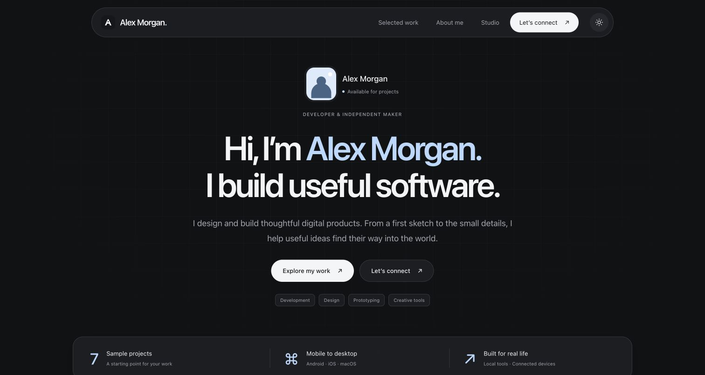
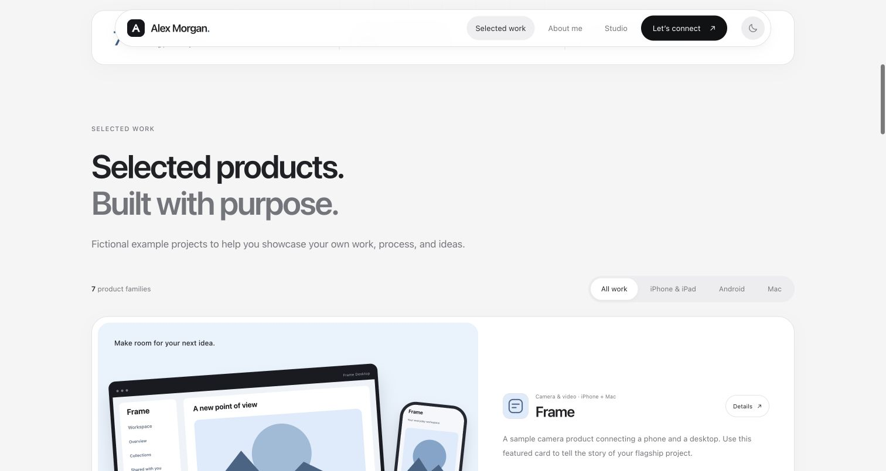
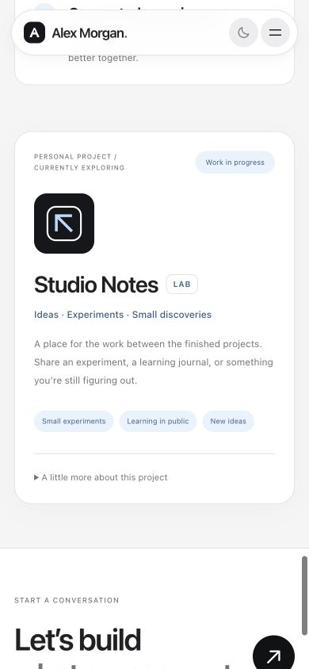

# Portfolio template

A responsive portfolio for developers, designers, and independent makers. A quiet grid, floating navigation, soft cards, and a black/white/gray palette with light-blue accents. Plain HTML, CSS, and JavaScript. No dependencies, package installation, or build step.

**Free for personal and commercial use. No attribution required.** Use it, change it, redistribute it, or sell your version under the [0BSD license](LICENSE).

[Live demo](https://iengphogit.github.io/portfolio-template/) · [Use this template](https://github.com/new?template_name=portfolio-template&template_owner=iengphogit)



<details>
<summary>Dark theme, project cards, and mobile previews</summary>





</details>

## Get started

Choose **Use this template → Create a new repository** on GitHub to start your own independent project, or clone this repository:

```sh
git clone https://github.com/iengphogit/portfolio-template.git
cd portfolio-template
npm start
```

Open **http://127.0.0.1:4186**. The optional preview server requires Node.js 18 or newer. No `npm install` is needed.

```sh
npm run check
```

To choose another port:

```sh
PORT=4187 npm start
```

Environment values come from your shell or hosting provider. `.env.example` documents the options; it is not loaded automatically.

## What is included

- Responsive layouts and a compact mobile navigation menu.
- Light and dark themes, with the visitor's choice saved locally.
- Seven fictional sample projects with platform filters.
- Native product dialogs with Escape-to-close and focus restoration.
- An about section, current-project section, and contact links.
- Keyboard focus styles, a skip link, filter announcements, and reduced-motion support.
- Original SVG mockups, geometric icons, and an illustrated avatar.
- System fonts, with no bundled fonts or external font requests.
- No analytics, trackers, third-party scripts, or runtime dependencies.

## Make it yours

| File | What to change |
| --- | --- |
| `dist/index.html` | Name, biography, hero, cards, skills, current project, contact links, page title, and social metadata |
| `dist/site.js` | The `productData` object for each detail dialog, plus the theme storage key if needed |
| `dist/theme.css` | Colors in `:root`, dark-theme tokens, typography, spacing, and responsive rules |
| `dist/assets/` | Avatar, project illustrations, icons, and favicon |
| `dist/robots.txt`, `dist/sitemap.xml` | Replace the example domain with your own |
| `dist/404.html` | Your name and the home/asset paths for your hosting location |

The sample person, projects, interfaces, and claims are fictional demonstration content. Replace `Alex Morgan`, `hello@example.com`, every `https://example.com` placeholder, and the published demo URL `https://iengphogit.github.io/portfolio-template/` before launching your portfolio. Sample project links intentionally lead to placeholder URLs. Card summaries live in HTML; the corresponding dialog content lives in `productData` in JavaScript.

To add a project, duplicate an `<article class="project">` in `dist/index.html` and add a matching entry to `productData`. Its `data-product` button value must match the object key. `data-platform` is a space-separated list matching the filter buttons. Update the initial project count when adding or removing cards.

You may use all included demo SVGs as-is, replace them, or edit them. No visible credit, backlink, or copyright notice is required by this project's license. Check the rights to any third-party photos, fonts, or other assets you add yourself.

## Deploy

Upload the contents of **`dist/`** to any static host. The site requires no backend. A GitHub Pages workflow is included but runs only when you manually start it:

1. In your repository, open **Settings → Pages** and select **GitHub Actions** as the source.
2. Open **Actions → Deploy static portfolio → Run workflow**.
3. Use the URL shown by the deployment. Set your real canonical URL, sitemap domain, and social metadata before sharing the site publicly.

Relative asset paths support GitHub Pages project URLs. For a custom 404 page on a project URL, set its home and asset links to your repository's base path.

You can also run `node server.mjs` on an existing Node host. Configure `HOST` and `PORT` as required by that host. Its public content is limited to `dist/`, with a plain `/healthz` endpoint. Put HTTPS in front of the Node server. The source repository does not contain any hosting account or tunnel configuration.

## License

**[BSD Zero Clause License (0BSD)](LICENSE).** Permission is granted to use, copy, modify, and distribute the software for any purpose, with or without a fee. You do not have to retain a notice, publish your changes, or credit the author. The software is provided as-is, without warranty.

The license covers this repository's code, documentation, and original demo artwork. There are no bundled third-party fonts, photographs, app-store screenshots, or icon libraries. Asset provenance is recorded in [`sources.json`](sources.json).

[Read the OSI license text](https://opensource.org/license/0bsd).
